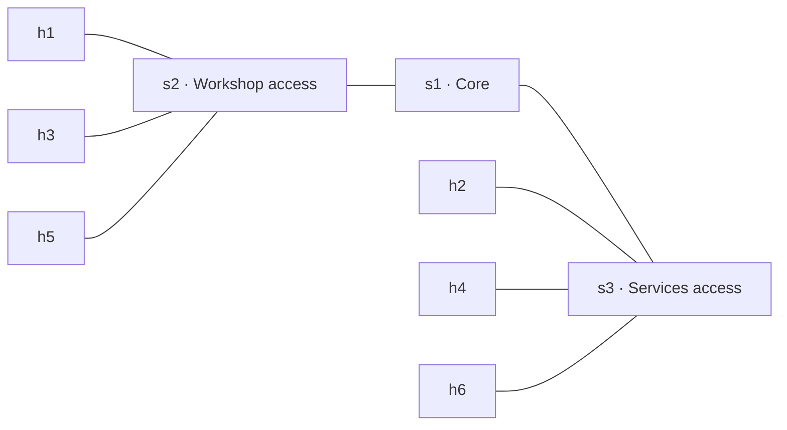

# Week 2 — Networks as Data

This lab turns a structured topology description into a Mininet network. The
same data also generates a published topology page. The config uses only the
last four digits of the matric ID (`4903`): IPv4 block `10.3.0.0/16` and IPv6
block `fd00:4903::/32`.

## My design

I designed a small campus lab as a core-and-access tree. The core bridge s1
connects the workshop access bridge s2 and services access bridge s3. Hosts
h1, h3, and h5 attach to the workshop segment; h2, h4, and h6 attach to
services. The h1-to-h2 path crosses s2, s1, and s3. The topology has no Layer 2
loop, and every host has IPv4 and IPv6 addresses from my assigned blocks.



The published page builds its Mermaid diagram from the links and switch labels
in `topology.yaml`, so the illustration follows the network data.

## Published Week 2 page

[Open the Week 2 network page](https://cheonglihua.github.io/wic2005-lab-portfolio/week-02/).

## Files

- `topology.yaml` — checked, labelled core-and-access design with three
  switches and six dual-stack hosts.
- `topology.json` — same model in JSON serialization.
- `build_topo.py` — validates both address families and link endpoints before
  starting Mininet.
- `bad.yaml` — duplicate IPv4/IPv6 addresses and a link to missing switch s9,
  for the pre-build validation exercise.
- `make_page.py` and `page.yaml` — generate the Week 2 page from topology,
  written answers, and collected evidence.
- `evidence/` — captured validation, ping, neighbour, bridge MAC, and DAD
  outputs from the live network.
- `run_lab.ps1` — starts the course container and interactive Mininet CLI.

## Build the network

Start Docker Desktop, open PowerShell in this folder, and run:

```powershell
.\run_lab.ps1
```

At `mininet>` check the topology and connectivity:

```text
net
pingall
h1 ping -6 -c 1 fd00:4903::2
h1 ip neigh
```

`pingall` should show 0% dropped (30/30 directed checks for six hosts). The
IPv6 ping tests Neighbour Discovery. In `h1 ip neigh`, look for h2's IPv4 and
IPv6 entries. The builder waits for IPv6 Duplicate Address Detection to
complete before presenting the Mininet prompt. Type `exit` to stop Mininet and
the container.

## Check invalid data before building

From this folder on the laptop, use the course container to run the check and
save its real output locally:

```sh
docker run --rm --privileged -v "${PWD}:/lab" -w /lab \
  firdaussahran/netlab-mininet:1.0 \
  python3 build_topo.py --check-only bad.yaml > evidence/check.txt 2>&1
cat evidence/check.txt
```

The output should identify both duplicate addresses and the unknown `s9`
endpoint. The command uses `--check-only` so this intentionally invalid file
never starts a network. Restore the valid file by building from
`topology.yaml`.

## Collect live evidence

Build with `python3 build_topo.py topology.yaml`, then at `mininet>` run:

```text
pingall
h1 ping -6 -c 1 fd00:4903::2
h1 ip neigh > /lab/evidence/neigh.txt
sh brctl showmacs s1 > /lab/evidence/macs.txt
h2 ip -6 addr add fd00:4903::1/64 dev h2-eth0
h2 ip addr add 10.3.0.1/24 dev h2-eth0
sh sleep 3
h2 ip -6 addr show dev h2-eth0 > /lab/evidence/dad.txt
h2 ip -4 addr show dev h2-eth0 >> /lab/evidence/dad.txt
exit
```

Copy the `pingall` summary printed in the terminal into
`evidence/pingall.txt`. The final commands deliberately give h2 copies of h1's
addresses to show IPv6 Duplicate Address Detection and IPv4's lack of an
equivalent built-in check. Regenerate `topology.yaml` from its valid version
if you edit it during the duplicate-address experiment.

The evidence files contain the outputs from a successful run of this topology.
The recorded `pingall` result is 0% dropped (30/30); the IPv6 ping succeeds,
and the duplicate-address output shows IPv6 DAD rejecting the duplicate while
IPv4 accepts it.

## Generate the portfolio page

With the course container available, from this directory run:

```sh
python3 make_page.py
```

This validates `topology.yaml` and writes `../docs/week-02/index.html`. It
shows any evidence files still missing. The repository setting and short
reflection answers are in `page.yaml`; revise them in your own words if needed.

## Git workflow

The Week 2 work is committed and pushed in milestone commits. Review its
history with:

```sh
git log --oneline -- week-02
```

When the topology or page data changes, run `python3 make_page.py`, inspect
`git diff`, and commit the updated data and generated page. Pushing to `main`
triggers the existing Pages workflow, which publishes the root `docs/`
directory. The published Week 2 link is at the top of this README.
